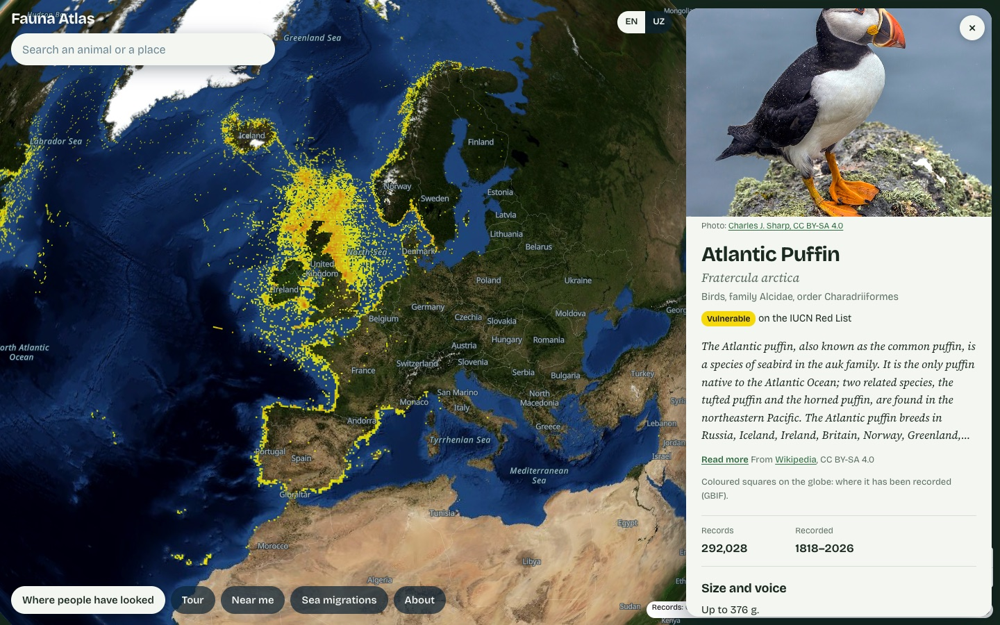
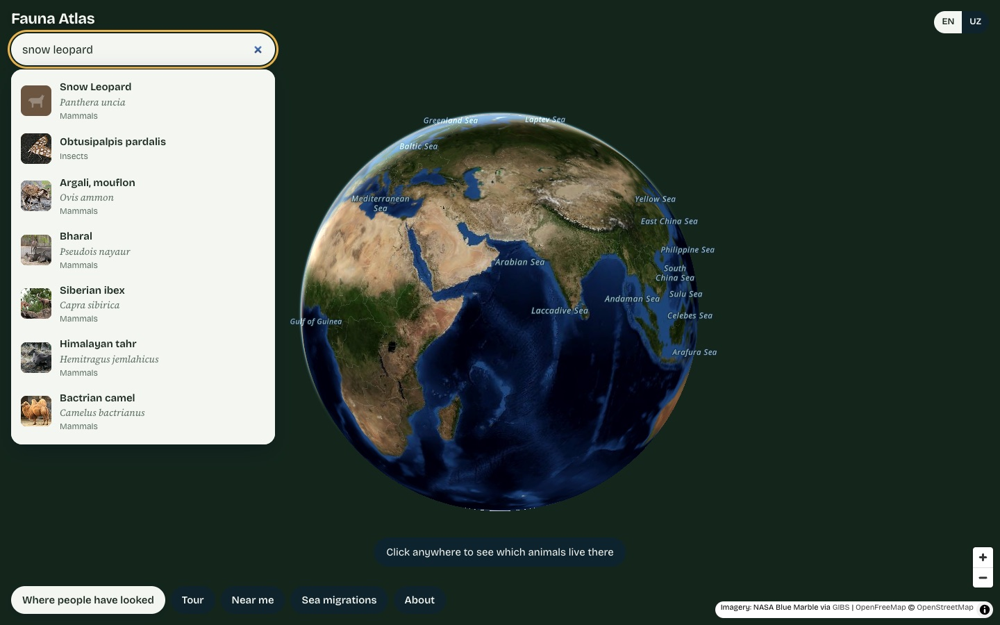
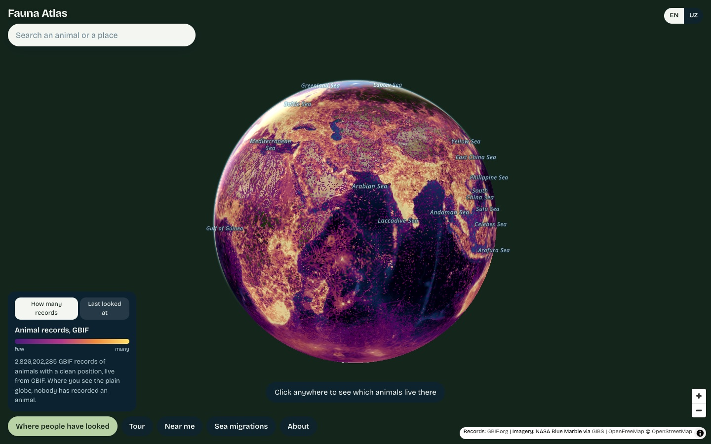
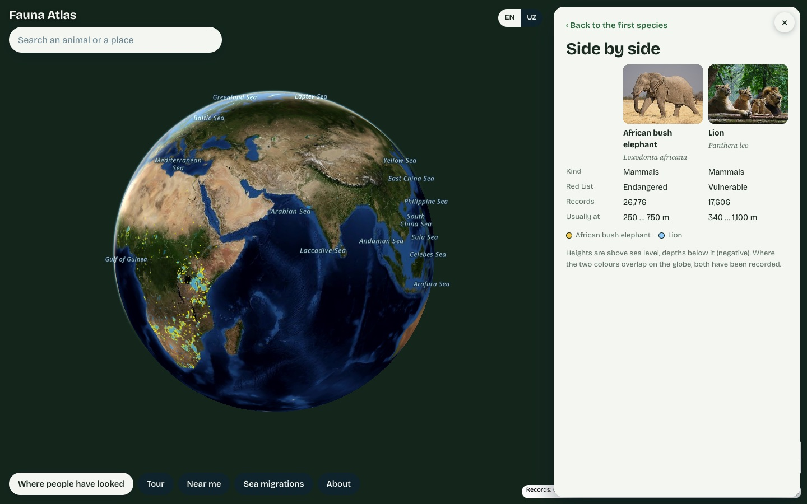
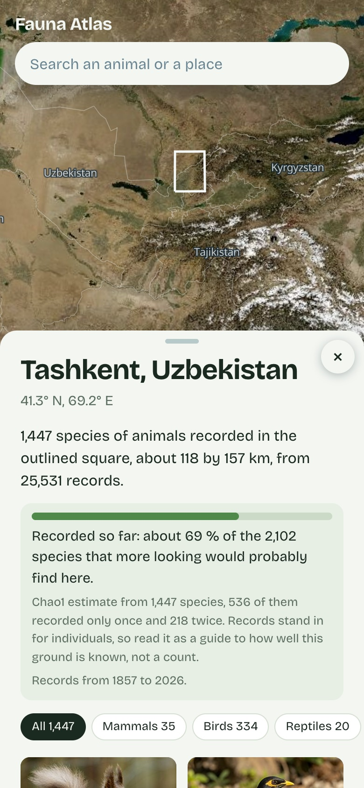

# Fauna Atlas

**Click anywhere on Earth and see which animals live there, and where nobody has looked yet.**
An open atlas of animal life on a 3D globe, built on GBIF and Wikidata.

**[fauna.bristleconelab.org](https://fauna.bristleconelab.org)**


## What it does

- **Who lives here.** Click a spot to list the animals recorded in a square about 150 km across, with photos and
  everyday names, filtered by kind (mammals, birds, reptiles, frogs, fish, insects, spiders, molluscs and more).
- **How well is it known.** A Chao1 estimate of how complete the list probably is, and the years of the first and last
  record. The Serengeti: 1,934 species recorded, about 72 % of the ~2,670 that more looking would likely find.
- **Any animal.** Search by everyday name in any language Wikidata knows, or by scientific name: where it has been
  recorded, its Red List status, how high or deep it lives, when in the year it is seen, size, lifespan and voice.
- **Where people have looked.** Record density of all ~2.8 billion animal records in GBIF, or where nobody has recorded
  an animal for ten years.
- **Compare and share.** Two species side by side, then-and-now maps, a CSV of any square's list, a citation, and a link
  for every place and species. English and Uzbek interface.

| Species page | Search |
|---|---|
|  |  |
| **Where people have looked** | **Side by side** |
|  |  |

<p align="center"></p>

## Data

Everything is fetched live by the browser from open services; the site has no server, cookies or analytics.

| What | Source | Licence |
|---|---|---|
| Animal records, lists, maps, heights, depths, dates | [GBIF](https://www.gbif.org) occurrence search and map API | per dataset: CC0, CC BY, CC BY-NC |
| Names and classification | GBIF Backbone Taxonomy | CC BY 4.0 |
| Photos, names in your language, size, lifespan, sounds | [Wikidata](https://www.wikidata.org) via [QLever](https://qlever.dev), Wikimedia Commons, iNaturalist (open licences only) | CC0 / each file's licence |
| Summaries | Wikipedia | CC BY-SA 4.0 |
| Red List status | IUCN, through GBIF | |
| Places | OpenStreetMap (Photon, Nominatim, OpenFreeMap), Marine Regions | ODbL, CC BY 4.0 |
| Sea migrations | [MiCO](https://doi.org/10.1038/s41467-025-59271-7), Bentley et al. 2025 | CC0 |
| Imagery | NASA Blue Marble (GIBS), Sentinel-2 cloudless 2016 by EOX | public domain, CC BY 4.0 |

## Limits

A species list records what was found, not a census: birds are recorded millions of times a year, most insects never,
so short lists usually mean few people looked. Squares are 1.4° on a side, GBIF coarsens the positions of species at
risk from poachers, and many records carry no height or depth. GBIF limits request rates, so a busy moment can slow a
list down.

## Development

```sh
npm install
npm run dev      # http://localhost:5173
npm test         # unit tests
npm run build    # typecheck + production build in dist/
npm run shots    # regenerate these screenshots (node scripts/screenshots.mjs <url>)
```

Pushes to `main` are tested, built and deployed to Cloudflare Pages by GitHub Actions.

## Related

[Ocean Life Atlas](https://oceanlife.bristleconelab.org) (the sea in depth, with tag tracks) ·
[Seafloor Atlas](https://seaflooratlas.org) · part of [bristlecone lab](https://github.com/bristleconelab)

Code: [MIT](LICENSE). Data: see the licences above.
