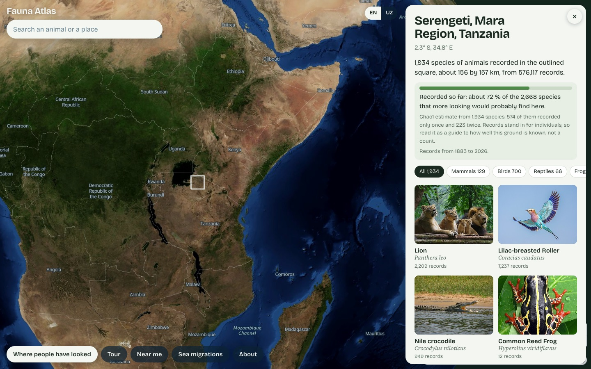

<picture>
  <source media="(prefers-color-scheme: dark)" srcset="public/brand/fauna-atlas-logo-dark.svg">
  
</picture>

**Click anywhere on Earth and see which animals live there, and where nobody has looked yet.**

[**fauna.bristleconelab.org**](https://fauna.bristleconelab.org)

<a href="https://github.com/bristleconelab"><picture><source media="(prefers-color-scheme: dark)" srcset="public/brand/bristleconelab-mark-light-128.png"></picture></a>&nbsp; powered by [**bristlecone lab**](https://github.com/bristleconelab)

An open atlas of animal life on a 3D globe, built on [GBIF](https://www.gbif.org) and [Wikidata](https://www.wikidata.org).

- **Who lives here.** Click a spot to list the animals recorded in a square about 150 km across, with photos and
  everyday names, filtered by kind: mammals, birds, reptiles, frogs, fish, insects, spiders, molluscs and more.
- **How well is it known.** An estimate of how complete the list probably is, and when someone last looked. The
  Serengeti: 1,934 species recorded, about 72 % of the ~2,670 that more looking would likely find.
- **Any animal.** Search by everyday name in any language Wikidata knows, or by scientific name: where it has been
  recorded, its Red List status, how high or deep it lives, when in the year it is seen, size, lifespan and voice.
- **Where people have looked.** All ~2.8 billion animal records in GBIF on one globe, or where nobody has recorded an
  animal for ten years.
- **Compare and share.** Two species side by side, then-and-now maps, a CSV of any square's list and a link for every
  place and species. English and Uzbek.
- **A page for each of 2,999 animals and 250 countries and territories.** [The best-known animals](https://fauna.bristleconelab.org/animals/)
  (photo, summary, Red List, a map of records, the countries they are recorded in) and [animals by country](https://fauna.bristleconelab.org/places/),
  plain pages that search engines read, each opening into the globe.

| Any animal: where it has been recorded | Where people have looked |
|---|---|
|  |  |

## Data

Everything is fetched live by the browser from open services; the site has no server, cookies or analytics.

| What | Source | Licence |
|---|---|---|
| Animal records, lists, maps, heights, depths, dates | [GBIF](https://www.gbif.org) occurrence search and map API | per dataset: CC0, CC BY, CC BY-NC |
| Names and classification | GBIF Backbone Taxonomy | CC BY 4.0 |
| Photos, names in your language, size, lifespan, sounds | [Wikidata](https://www.wikidata.org) via [QLever](https://qlever.dev), Wikimedia Commons, iNaturalist (open licences only) | CC0 / each file's licence |
| Summaries | Wikipedia | CC BY-SA 4.0 |
| Red List status | IUCN, through GBIF | |
| Places | OpenStreetMap (Photon, Nominatim, OpenFreeMap), Marine Regions | ODbL, CC BY 4.0 |
| Sea migrations | [MiCO](https://doi.org/10.1038/s41467-025-59271-7), Bentley et al. 2025 | CC0 |
| Imagery | NASA Blue Marble (GIBS), Sentinel-2 cloudless 2016 by EOX | public domain, CC BY 4.0 |

A species list records what was found, not a census: birds are recorded millions of times a year, most insects never,
so a short list usually means few people looked. GBIF coarsens the positions of species at risk from poachers.

## Related

[Ocean Life Atlas](https://oceanlife.bristleconelab.org): the sea in depth, with tag tracks ·
[Seafloor Atlas](https://seaflooratlas.org): the ocean floor

Code: [MIT](LICENSE). Data: see the licences above.
